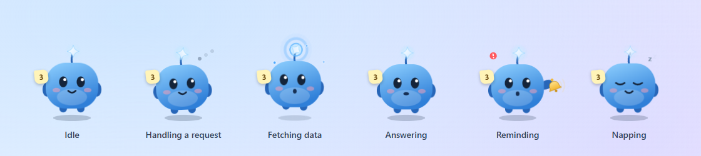
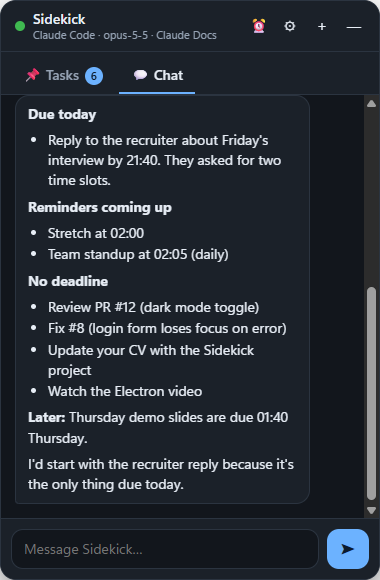
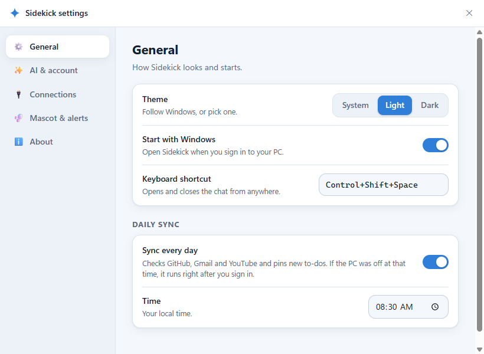
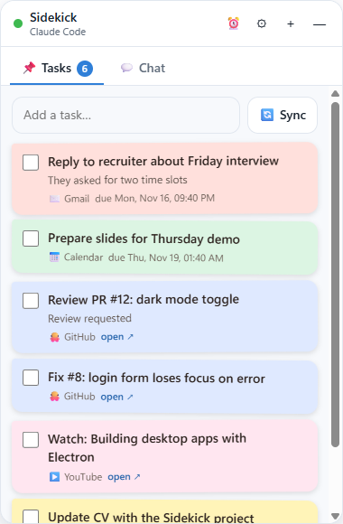

# Sidekick

A cute desktop companion for Windows that runs on **your own Claude Code login** (Pro/Max plan).
No API key. A little blue mascot lives on your screen: it blinks, watches your cursor, hops around,
naps when you're away, thinks while Claude works, sends out signal waves while it fetches your data,
and rings a bell when a reminder is due. Click it to chat.




Built with **Tauri 2 (Rust)** and **React + TypeScript**: a ~2 MB installer, low memory use, and
no local network port.

## Install

Requirement: Claude Code installed and signed in (run `claude` in a terminal once).

1. Download **Sidekick_<version>_x64-setup.exe** from [Releases](../../releases) and run it.
   Windows SmartScreen may warn because the app isn't code-signed: click **More info → Run anyway**.
2. Sidekick starts right away, and from then on at every Windows login.

**Upgrading from 0.x:** uninstall the old Sidekick first (Windows Settings → Apps → Sidekick), so
only one copy starts at login. Your tasks, reminders, notifications and settings carry over: 1.0
uses the same data folder (`%APPDATA%\Sidekick`) and file formats.

## Use it

- **Click the mascot** to open or close the chat. **Drag** it anywhere. **Right-click** it for the menu.
- **Ctrl+Shift+Space** toggles the chat from anywhere; **Esc** closes it.
- Try: *"remind me in 2 minutes to drink water"*, *"every weekday at 9 remind me to check job boards"*.

<p></p>

## Notifier

A chat-bubble mini dashboard above the mascot. It pops up when something happens (a reminder fires,
a sync finishes, Claude pins a new task) and when you hover the mascot. It shows your open tasks, the
next reminder and the last sync, plus a list of recent notifications you can open or dismiss.


## Settings

Click ⚙ (chat window or notifier), or right-click the mascot → **Settings…**

| Tab | What's there |
|---|---|
| General | Theme (system / light / dark), start with Windows, keyboard shortcut, daily sync time |
| AI & Account | Claude Code sign-in (Claude subscription or Anthropic Console), model, effort, response style, reply language |
| Connections | GitHub / YouTube / Gmail / Calendar / web on-off, claude.ai connectors (authorize), your own MCP servers, auto-approved tools, YouTube channels |
| Mascot & notifications | Show/hide, size, nap timer, notifier behaviour, custom mascot image |
| About | Versions, Claude Code path, data folder, copy diagnostics |

Sidekick runs on Claude Code, so it uses Claude models only.

| | |
|---|---|
|  |  |
|  |  |

## Task board

The chat window opens on **📌 Tasks**, a sticky-note board of things you need to do.

- Add your own, tick them off, or remove them. Finished tasks fold away and are cleared after a week.
- **🔄 Sync** asks Claude Code to check GitHub, Gmail and YouTube and pin anything that needs you,
  with a link to open it. A sync also runs every day at the time set in Settings (default 08:30),
  or right after login if the PC was off at that time.
- Claude can manage the board from chat too: *"add a task to email my professor"*, *"what's on my plate?"*.
- The mascot carries a little sticky note with your open-task count.

<p></p>

## Connections

| Service | How | Setup |
|---|---|---|
| GitHub | Your `gh` CLI login (read-only): PRs waiting for your review, assigned issues, your PRs, notifications | `gh auth login` once |
| Gmail, Google Calendar | claude.ai connectors, used by Claude Code | claude.ai → Settings → Connectors → connect them |
| YouTube | Public channel feeds, no account needed | Say *"follow @fireship on YouTube"* |

Sidekick never sends, deletes or changes anything unless you ask in the chat.

## Custom mascot

Put an image named `mascot.png`, `mascot.gif` or `mascot.webp` (about 120×120, transparent background,
up to 5 MB) in the data folder (right-click mascot → Open data folder) and restart. It gets the same
hops, jumps and naps as the built-in one.

## How it works

```
Windows login
 └─ Sidekick.exe  (Rust, Tauri 2)
     ├─ core: chat history, notifications, task board, reminders (checked every 15 s), daily sync
     │    └─ claude -p  (your Claude Code login, one long-lived session)
     │         ├─ Sidekick.exe --mcp   → reminders, task board, GitHub, YouTube tools
     │         ├─ WebSearch, WebFetch
     │         └─ your claude.ai connectors (Gmail, Calendar, Drive… once authorized on claude.ai)
     └─ windows (React + TypeScript in WebView2): mascot + notifier, chat, settings; tray icon
```

The windows talk to the Rust core over Tauri's built-in IPC. There is no local web server, so no
port that other programs or web pages could reach.

## Safety defaults

- No network server; the UI can only call Sidekick's own commands (Tauri capabilities), not the
  file system or shell. The content security policy only allows Sidekick's own scripts.
- Claude Code gets only WebSearch and WebFetch as built-in tools: no shell, no file edits. Connector
  tools are blocked until you allow them in Settings.
- Links in chat, tasks and notifications open in your normal browser, never inside Sidekick.

## Config file

Everything in Settings is saved to `%APPDATA%\Sidekick\config.json` and applied right away
(changes to model, effort, style, language, tools or MCP servers restart Claude Code, keeping the chat).
Editing the file by hand also works; Sidekick picks the change up within a couple of seconds.

## Develop

Requirements: Node 20+, Rust (stable, via rustup) and the Microsoft C++ Build Tools with the Windows SDK.

```bash
npm install
npm run dev        # run with hot reload (Vite + Tauri)
npm run build      # release build + installer → src-tauri/target/release/bundle/nsis/
npm run typecheck  # TypeScript (UI)
npm test           # Rust unit tests (settings validation, tasks, reminders, 0.x file compatibility)
npm run icon       # redraw the app icon and regenerate the Windows icons
```

| Path | Role |
|---|---|
| `src-tauri/src/core.rs` | Chat history, notification feed, sync, scheduler, file watching, settings, info |
| `src-tauri/src/claude.rs` | Runs and talks to the Claude Code CLI (`stream-json` mode), system prompt |
| `src-tauri/src/mcp.rs` | Sidekick's MCP tool server (`Sidekick.exe --mcp`, JSON-RPC over stdio) |
| `src-tauri/src/shell.rs` | Windows, click-through, eye tracking, dragging, tray, menus, shortcut, autostart, theme |
| `src-tauri/src/commands.rs` | Commands the UI calls |
| `src-tauri/src/config.rs` | Settings defaults, choices and validation |
| `src-tauri/src/store.rs` | Tasks and reminders storage |
| `src-tauri/src/integrations.rs` | GitHub (via `gh`) and YouTube (RSS) readers |
| `src/panel/` | Chat + task board window (React) |
| `src/mascot/` | The mascot (SVG + CSS animations, moods) and the notifier (React) |
| `src/settings/` | Settings window (React) |
| `src/lib/` | Typed bridge to the Rust commands, live events, markdown, shared types |

## Roadmap

- [ ] Smarter heartbeat: nudge during the day only when something urgent arrives
- [ ] Approve or deny a tool the moment Claude asks for it
- [ ] Telegram channel to message it from your phone
- [ ] More mascot moods and outfits
