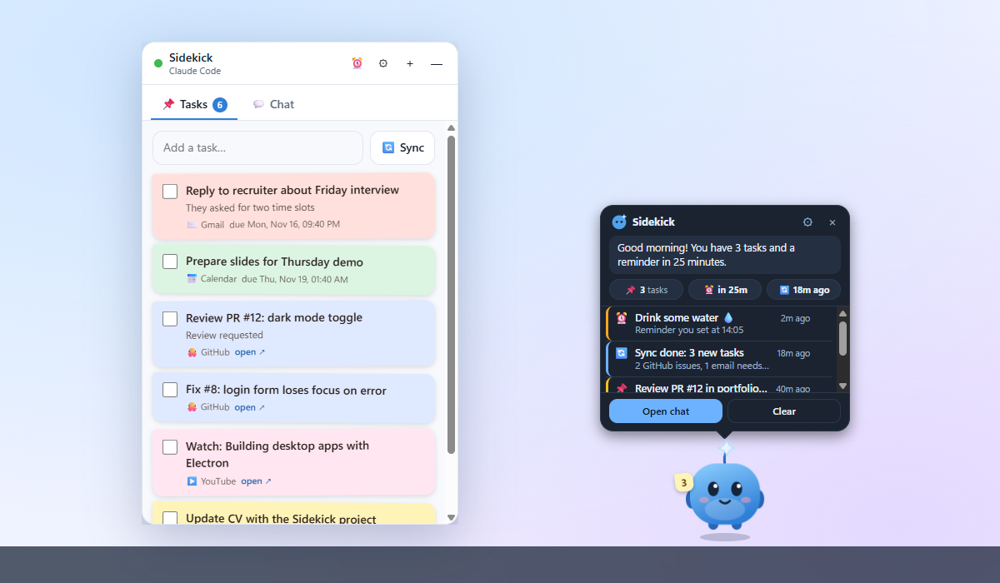
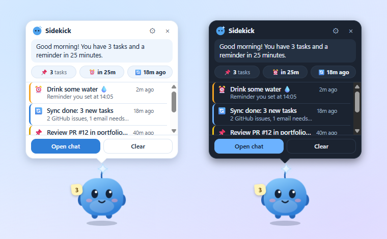
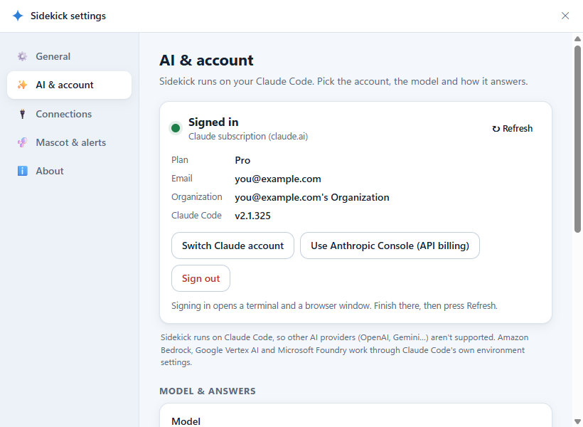
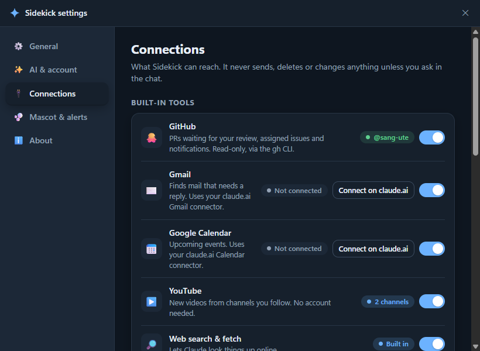
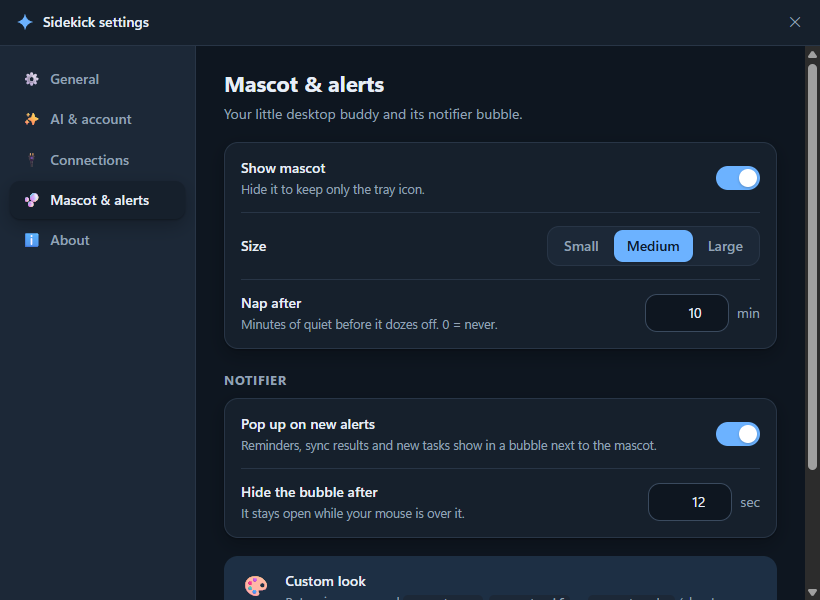

# Sidekick

A cute desktop companion for Windows that runs on **your own Claude Code login** (Pro/Max plan).
No API key. A little blue mascot lives on your screen: it blinks, watches your cursor, hops around,
naps when you're away, thinks while Claude works, sends out signal waves while it fetches your data,
and rings a bell when a reminder is due. Click it to chat.




## Install

Requirement: Claude Code installed and signed in (run `claude` in a terminal once).

1. Download **Sidekick Setup <version>.exe** from [Releases](../../releases) (or build it with `npm run dist`) and run it. Windows SmartScreen may warn because the app isn't
   code-signed: click **More info → Run anyway**.
2. Sidekick starts right away, and from then on at every Windows login.

## Use it

- **Click the mascot** to open or close the chat. **Drag** it anywhere. **Right-click** it for the menu.
- **Ctrl+Shift+Space** toggles the chat from anywhere; **Esc** closes it.
- Try: *"remind me in 2 minutes to drink water"*, *"every weekday at 9 remind me to check job boards"*.

<p></p>

## Notifier

A chat-bubble mini dashboard above the mascot. It pops up when something happens (a reminder fires,
a sync finishes, Claude pins a new task) and when you hover the mascot. It shows your open tasks, the
next reminder and the last sync, plus a list of recent notifications you can open or dismiss.



## Settings

Click ⚙ (chat window or notifier), or right-click the mascot → **Settings…**

| Tab | What's there |
|---|---|
| General | Theme (system / light / dark), start with Windows, keyboard shortcut, daily sync time |
| AI & Account | Claude Code sign-in (Claude subscription or Anthropic Console), model, effort, response style, reply language |
| Connections | GitHub / YouTube / Gmail / Calendar / web on-off, claude.ai connectors (authorize), your own MCP servers, auto-approved tools, YouTube channels |
| Mascot & notifications | Show/hide, size, nap timer, notifier behaviour, custom mascot image |
| About | Versions, Claude Code path, data folder, copy diagnostics |

Sidekick runs on Claude Code, so it uses Claude models only.

| | |
|---|---|
|  |  |
|  |  |

## Task board

The chat window opens on **📌 Tasks**, a sticky-note board of things you need to do.

- Add your own, tick them off, or remove them. Finished tasks fold away and are cleared after a week.
- **🔄 Sync** asks Claude Code to check GitHub, Gmail and YouTube and pin anything that needs you,
  with a link to open it. A sync also runs every day at `dailySyncTime` (default 08:30), or right
  after login if the PC was off at that time.
- Claude can manage the board from chat too: *"add a task to email my professor"*, *"what's on my plate?"*.
- The mascot carries a little sticky note with your open-task count.

<p></p>

## Connections

| Service | How | Setup |
|---|---|---|
| GitHub | Your `gh` CLI login (read-only): PRs waiting for your review, assigned issues, your PRs, notifications | `gh auth login` once |
| Gmail, Google Calendar | claude.ai connectors, used by Claude Code | claude.ai → Settings → Connectors → connect them |
| YouTube | Public channel feeds, no account needed | Say *"follow @fireship on YouTube"* |

Sidekick never sends, deletes or changes anything unless you ask in the chat.

## Custom mascot

Put an image named `mascot.png`, `mascot.gif` or `mascot.webp` (about 120×120, transparent background)
in the data folder (right-click mascot → Open data folder) and restart. It gets the same hops, jumps
and naps as the built-in one.

## What starts at login

```
Windows login
 └─ Sidekick.exe
     ├─ local server  127.0.0.1:47821  (UI, chat stream, reminders; token-protected)
     │    └─ claude -p  (your Claude Code login, one long-lived session)
     │         ├─ sidekick MCP server  → reminders, task board, GitHub, YouTube
     │         ├─ WebSearch, WebFetch
     │         └─ your claude.ai connectors (Gmail, Calendar, Drive… once authorized on claude.ai)
     ├─ reminder scheduler (every 15s) → Windows notification + mascot speech bubble
     └─ mascot window + chat window + tray icon
```

## Safety defaults

- The server listens on `127.0.0.1` only, checks the `Host` header, and every API call needs a random
  token created at each start, so web pages you visit can't drive Claude Code.
- Claude Code gets only WebSearch and WebFetch as built-in tools: no shell, no file edits. Connector
  tools are blocked until you allow them in the config.

## Config file

Everything in Settings is saved to `%APPDATA%\Sidekick\config.json` and applied right away
(changes to model, effort, style, language, tools or MCP servers restart Claude Code, keeping the chat).
Editing the file by hand also works; Sidekick picks the change up within a couple of seconds.

## Develop

```bash
npm install
npm start          # run from source
npm run server     # just the local server; open the printed URL in any browser
npm run dist       # build the installer into dist/
npm run screenshots  # regenerate docs/screenshots (sample data; runs one short real chat)
```

| File | Role |
|---|---|
| `src/main.js` | Electron shell: mascot, chat and settings windows, tray, shortcut, theme, launch at login |
| `src/server.js` | Local HTTP server: live event stream, settings, notifications, reminder scheduler, sync |
| `src/config.js` | Settings defaults, choices and validation |
| `src/claude.js` | Runs and talks to the Claude Code CLI (`stream-json` mode) |
| `src/mcp-sidekick.js` | MCP tool server Claude Code launches: reminders, tasks, GitHub, YouTube |
| `src/tasks.js` | Task board storage |
| `src/integrations.js` | GitHub (via `gh`) and YouTube (RSS) readers |
| `src/reminders.js` | Reminder storage shared by the two above |
| `renderer/mascot.*` | The desktop mascot (SVG + CSS animations, moods) and the notifier |
| `renderer/index.html`, `app.js` | Chat + task board UI, works in the app and in a browser tab |
| `renderer/settings.*` | Settings dashboard |

## Roadmap

- [ ] Smarter heartbeat: nudge during the day only when something urgent arrives
- [ ] Approve or deny a tool the moment Claude asks for it
- [ ] Telegram channel to message it from your phone
- [ ] More mascot moods and outfits
